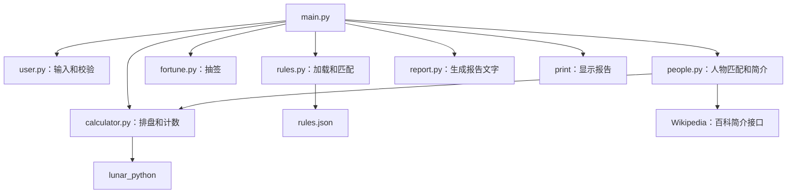
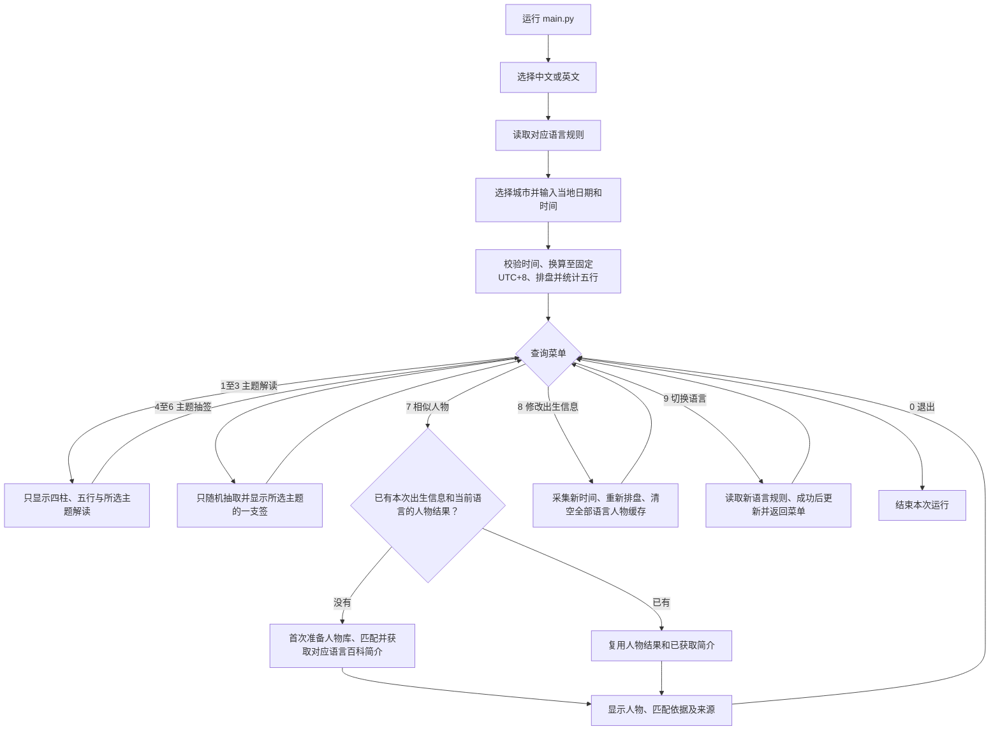

# suanming 开发指南：终端 MVP 与后端扩展

更新日期：2026-10-29。项目目录：`/Users/liuliu/Desktop/suanming`。

2026-10-29 当前状态：**后端 HTTPS 已部署并验证，Lovable 网站已发布；整站流程待手动验收。** 网站为 [https://doc-to-dreamsite.lovable.app](https://doc-to-dreamsite.lovable.app)，API 基地址为 [https://fortune-telling-api-rlt2.onrender.com](https://fortune-telling-api-rlt2.onrender.com)。公开首页、动态城市列表、中英文首页及实际来源的 API `GET`／`OPTIONS` 已确认。用户已用上海、2003-04-01、14:15 手动确认出生提交及财运报告正常；其余主题、抽签、人物、结果页语言切换、返回与退出仍待手动验收。Render 免费服务的既有后端业务检查通过；部分百科简介不可用时已有备用说明和原文链接。

最终交付为公众直接打开 Lovable 网站即可使用；Render 托管现有 Python API，GitHub 保存代码。当前通过公开仓库 URL 创建 Blueprint，未安装 GitHub 仓库集成；采用手动部署，配置为 `autoDeployTrigger: off`。后续推送到 `main` 后仍需在 Render 选择 `Deploy latest commit`。详情见[Render部署说明](Render部署说明.md)与[Lovable公网接入补充说明](Lovable公网接入补充说明.md)。

## 1. 当前进度

最新业务决定“先填出生信息＋单层编号菜单”已实现。本轮你明确授权助手直接修改代码及项目文件夹，最后由你手动测试；助手已修改四个 Python 文件并完成本地流程检查。第 5、14、16、18 节已同步为当前实现，手动测试见[手动测试清单](手动测试清单.md)。

终端 MVP 已由你亲手完成并运行通过：

```text
选择语言 → 读取规则 → 填写出生城市、日期与时间 → 排盘与五行计数
→ 单层菜单 → 仅显示所选解读／签文／人物 → 返回菜单，输入0退出
```

终端程序继续保留，本机 HTTP 与 Render 公网 HTTPS API 均已验证。启动与 JSON 示例见[API接口说明](API接口说明.md)。本机可信证书未配置，不是当前 Render 路线的前置条件。

本轮扩展已完成并由你运行通过：三个主题的名称与说明、财运／学习／桃花各五项文案（共十五项）、带主题参数的规则匹配，以及包含标题、动态依据、正文和行动提示的完整报告。木、土并列的结果已验证。

财运、学习运、桃花运各三支主题签已加入，共九支，另保留三支通用签。`lots(rules, topic=None)` 支持按主题抽签，`format_lot(lot, language="zh")` 单独排版签文。八字报告已移除签文，只有主动选择 4～6 才抽签。

查询菜单现在为：1～3 三主题解读、4～6 三主题抽签、7 人物、8 修改出生信息、9 切换语言、0 退出。启动必须先填写出生信息；主题包含在菜单编号里，不再显示第二层主题菜单。每个功能只显示自己的结果，随后回菜单。语言、城市、日期、时间、重复钟点选择和菜单均支持输入 0 结束整个程序。原菜单曾由你手动验证；新菜单本地检查已通过，待你手动验收。

日期与时区逻辑已接入：选择出生城市、输入当地时间、处理不存在或重复的钟点、拒绝未来出生时间，排盘时内部统一换算到固定 UTC+8。你已确认上海和悉尼的正常输入会得到相应的不同结果；助手已对当前保存的输入函数验证特殊钟点和未来时间重试。报告已显示当地时间和出生时区，入口提示也已同步为出生地当地时间。

人物模块已由你亲手编写并运行通过：新增 `people.py`，用有来源出生资料计算五行，匹配后通过免费百科接口获取所选语言的简介，再由 `report.py` 排版。`main.py` 已接通完整流程，同一出生信息切换主题复用人物结果，修改出生信息后重新匹配。完整 30 位资料见[人物资料清单](人物资料清单.md)，已由你整段替换 `PEOPLE` 并确认数量为 30；主程序中猫王、本笃十六世、塞尔日·甘斯布的中文匹配、简介和来源展示已确认通过，英文姓名、匹配说明、在线简介与来源也已从完整运行输出确认通过。按你的最新决定，人物模块暂时保留百科简介与来源，不加入生平时间线；时间线不作为当前阶段的待办或完成条件。

中英文已贯通启动语言选择、查询菜单、出生城市与时间输入、解读、抽签、完整报告及人物推荐；运行中输入 9 可切换语言并保留出生信息，切换本身不执行任何查询。HTTP API 同样支持 `zh/en`，Render 线上 HTTPS 已验证。

单层菜单一轮修改了 `main.py/user.py/report.py/i18n.py`。API 一轮新增 `api.py`，将纯时间解析移到 `birth_time.py` 供终端和 API 共用，并新增独立依赖、测试和接口文档。规则数据、排盘算法、人物资料保持原样。原 `.venv` 用于终端，新增 `.venv-api` 用于 API。

## 2. 已确认的下一阶段方向

1. 先完善 Python 业务逻辑和内容，继续在本机终端运行。
2. 保留财运、学习运、桃花运现有解读和各三支签，优先完成其余功能，整体功能完成后再扩充签文。
3. 网页可调用的接口、Render HTTPS 与 Lovable 网站发布已完成，下一步完成已发布网站的整站手动验收。
4. 暂不接数据库；账号注册登录、跨设备数据同步和长期历史记录留到后续。公开网页可由不同设备访问，不依赖这些功能。
5. 30 位人物的计算、匹配、百科简介和终端展示已完成；暂不扩充人物数量，也暂不加入生平时间线。
6. 中文业务功能完成后，统一补齐中英文界面、提示、报告、解读和签文；两种语言共用计算逻辑。
7. 日期判断与海外出生时间处理已接入，保留年月日和时分，用户填写出生地当地时间，程序按选定城市的历史时区规则处理冬夏令时。

已确认的范围缩减：解读只依据表层五行计数，不增加日主、十神等进阶玩法；不新增规则数据结构校验功能。现有日期输入重试、JSON 读取失败、未知主题和空签池提示继续保留。

本阶段先做出生八字的基础主题解读。指定年份的运势、大运流年的解释体系尚未明确，不在本轮默认加入。

## 3. 协作与教学约定

- 助手可以按你的要求维护本 Markdown。
- Python、JSON、依赖文件默认由你亲手编辑；只有你明确要求助手动代码时，助手才编辑这些文件。
- 本次你已明确要求“你来修改我的这个代码，以及这个文件夹。完成上述业务。最后我手动测试”，因此本轮由助手直接实现第 18 节流程，你负责最终手动验收。
- 随后你明确要求“现在给我生成api接口”，助手实现第 19 节的本机 API。2026-10-29 你又明确授权实际部署 Render，现已完成公网 HTTPS 与业务检查；没有安装本机系统证书。
- 每次只完成一个小步骤：说明目的 → 讲解相关概念 → 你编辑 → 运行验证 → 反馈结果。
- 有报错就先解决当前问题，再推进下一步。
- 先把财运的一个示例写清楚，再补齐同主题文案，最后扩展到学习、桃花；签文也分批增加。
- 使用你已经采用的函数名，避免教学命令和实际代码不一致。

## 4. 已确认的五页 Web 规划

五页方案已替代早期四页方案。Lovable 前端已公开发布，首页与后端基础连接已确认，完整业务交互仍待手动验收。

| 页面 | 主要功能 |
| --- | --- |
| 出生信息页 | 选择语言，填写或修改出生城市、日期和时分，验证后进入菜单 |
| 功能菜单页 | 三主题解读、三主题抽签、相似人物七个平级查询，以及改生日、切语言、退出 |
| 主题解读页 | 只展示四柱、表层五行和所选主题解读；三个主题共用模板 |
| 抽签结果页 | 只展示一支主题签及解签，用户主动操作才重新抽签 |
| 相似人物页 | 最多三位人物，简介与来源同页展开；无独立详情页或时间线 |

返回菜单保留出生信息；新出生信息验证成功后清空旧结果。网页切换语言保留当前结果，签文通过真实双语快照按 `(topic,id)` 翻译，不重新随机。退出清空本次出生信息和结果、保留语言。终端仍按第 18 节返回菜单，不自动重放旧结果。

具体业务以[Lovable本地Web需求说明](Lovable本地Web需求说明.md)为准，公网地址与部署状态以[Lovable公网接入补充说明](Lovable公网接入补充说明.md)为准。

## 5. 当前文件及实际函数

```text
suanming/
├── main.py           # 入口和流程组织
├── api.py            # FastAPI HTTP 入口，返回结构化 JSON
├── user.py           # 终端输入、日期时间校验
├── birth_time.py     # 共用的纯当地时间解析，不包含 input()
├── calculator.py     # 四柱和表层五行计算
├── rules.py          # JSON 读取、规则匹配
├── fortune.py        # 随机抽签
├── report.py         # 返回排版后的报告文字
├── people.py         # 人物出生资料、五行匹配、百科简介
├── i18n.py           # 中英文翻译表及 t() 模板填充函数，已接入现有终端流程
├── rules.json        # 解读文案与签文
├── rules_en.json     # 已由你导入的英文规则，已按所选语言接入主流程
├── requirements.txt  # lunar_python==1.4.8
├── requirements-api.txt # API 固定依赖，使用独立 Python 3.12 环境
├── requirements-dev.txt # API 测试依赖
├── tests/test_api.py # HTTP 接口契约与错误场景测试
├── openapi.json      # 当前 API 结构导出，供后续网页对接
├── MVP开发指南.md
├── 手动测试清单.md    # 当前单层菜单的运行与验收步骤
├── API接口说明.md     # 接口启动、浏览器测试与 JSON 示例
├── 人物资料清单.md    # 已整理的30位人物、出生资料来源及一次导入代码块
├── 英文规则导入.md    # 已整理的完整英文规则，供你复制到 rules_en.json
├── 八字报告双语接入.md # 已由你手动接入的报告双语教学材料
├── 人物推荐双语接入.md # 已由你手动接入的人物双语与分语言缓存教学材料
├── report完整恢复.md  # 旧流程恢复记录，已标为历史参考，不覆盖当前代码
├── prototype.rtf     # 最初的产品草稿，当前以本指南为准
├── .venv/            # 原终端 Python 3.9 环境
└── .venv-api/        # API Python 3.12 环境，已安装依赖
```

| 文件 | 当前实际接口 | 职责与结果 |
| --- | --- | --- |
| `main.py` | `MainApp.run()` | 调用各模块、传递数据、打印报告 |
| `api.py` | `app` | ASGI 应用，提供基础信息、排盘、主题解读、抽签和人物 HTTP 接口 |
| `user.py` | `input_or_exit(prompt, language="zh")` | 去除输入首尾空白；完整的 0、EOF 或 Ctrl+C 正常结束程序，普通输入返回字符串 |
| `user.py` | `choose_language(language="zh")` | 双语显示语言选项，返回 `zh/en`；启动和运行中切换均使用，退出语使用传入语言 |
| `user.py` | `birth_info(language="zh")` | 按语言接收当地日期和时分，处理特殊钟点与未来时间，返回带出生地时区的 `datetime` |
| `user.py` | `choose_timezone(language="zh")` | 按语言显示五个出生城市，返回相同的 IANA 时区名称；英文与非法编号重试已验证 |
| `birth_time.py` | `resolve_local_time(birth, zone_name)` | 将无时区的当地时间解析为 0、1 或 2 个有效候选；`user.py` 导入后继续可用 |
| `user.py` | `choose_topic(rules, language="zh")` | 保留供单独练习使用，当前主流程不调用；输入 0 也可退出 |
| `user.py` | `choose_action(language="zh")` | 显示单层菜单，返回 `(action, topic)`；功能为 `report/draw/people/birth/language`，不需要主题时为 `None`，0 直接退出 |
| `i18n.py` | `t(key, language="zh", **values)` | 按语言读取文字模板，再填入命名占位符；兼容无占位符调用 |
| `calculator.py` | `bazi(birth)` | 接收带时区的出生时间，在内部转为固定 UTC+8 后返回四柱与五行计数字典 |
| `rules.py` | `data_loader(language="zh")` | 从模块目录读取对应的 `rules.json/rules_en.json`，返回字典 |
| `rules.py` | `interpretation(chart, rules, topic=None, language="zh")` | 保留基础模式、三个主题及并列匹配，按语言生成动态依据与错误提示 |
| `fortune.py` | `lots(rules, topic=None)` | 从主题签池或通用签池随机返回一支签的字典 |
| `report.py` | `format_lot(lot, language="zh")` | 按语言返回签号、签名、签文及可选解签和行动提示的文字 |
| `report.py` | `format_report(birth, chart, reading, language="zh")` | 按语言整理出生信息、四柱、五行与主题解读，不包含签文或人物 |
| `report.py` | `format_people(matches, language="zh")` | 按语言整理姓名、五行、匹配方式、简介和两类来源，空列表显示对应语言的暂无匹配 |
| `people.py` | `PEOPLE` | 保存小型人物库的出生资料、出生来源和中英文百科词条名 |
| `people.py` | `prepare_people(people)` | 复用 `bazi()` 计算人物五行，返回补充计数和最多项的新列表 |
| `people.py` | `match_people(dominant_elements, people, limit=3)` | 完全相同的最多项集合优先，其余按共同项数量排序，最多返回三位 |
| `people.py` | `fetch_biography(person, language="zh")` | 从百科接口获取简介与原文链接；常见网络和解析错误返回备用说明 |
| `people.py` | `recommend_people(dominant_elements, people, language="zh", limit=3)` | 先匹配，再为入选者获取简介，返回结构化列表 |

`rules.py` 是执行代码；`rules.json` 是供代码读取的数据。

核心业务由 `main.py` 组织。`fortune.py` 的单独测试入口会导入 `data_loader`，但只在直接运行该文件时执行。各文件的测试入口须保持 `if __name__ == "__main__":` 顶格，避免导入时触发测试。



## 6. 当前输入与排盘口径

- 输入公历日期 `YYYY-MM-DD` 和 24 小时制时间 `HH:MM`。
- 用户选择出生城市，并输入出生地当地的日期与时间，不需要手动换算。
- 当前可选上海、悉尼、伦敦、纽约、东京，分别使用对应的 IANA 时区规则。
- `birth_info()` 返回原出生地时区的时间；不存在的当地钟点重输，重复钟点选择第一次或第二次，未来出生时间重输。
- `bazi()` 在函数内部将出生时刻转为固定 UTC+8，再调用排盘库；这一换算口径是本项目的实现约定。
- 报告展示原当地出生时间、当时的 UTC 偏移和出生时区，并附排盘口径说明。
- 完整四柱需要出生时刻，时间未知时不能默认填午夜并冒充完整八字。
- 继续使用 `lunar_python==1.4.8`，节气与干支排布交给库。
- 继续固定 `setSect(2)`：23:00—23:59 的日柱取当天，时柱使用库的结果。
- 五行计数按四柱八个字所属五行统计，主题解读仅依据这些表层数量。
- 当前没有真太阳时换算。

现有字段保持：

- `chart["pillars"]`：`year/month/day/time` 四柱字符串。
- `chart["element_counts"]`：木、火、土、金、水五项数量，合计 8。
- `reading`：`dominant_elements/missing_elements/text`。
- 指定主题时，`reading` 另外返回 `topic/topic_label/items`；每个匹配项含 `element/title/basis/text/advice`。
- `lot`：`id/title/text`；主题签另含 `interpretation/advice/topic/topic_label`。

## 7. 三个主题如何增加内容

稳定使用以下主题标识，显示名称可以调整：

| 标识 | 显示名称 | 本阶段内容方向 |
| --- | --- | --- |
| `wealth` | 财运 | 资源管理、机会、规划与积累的主题解读 |
| `study` | 学习运 | 学习方法、专注、复盘与持续练习的主题解读 |
| `romance` | 桃花运 | 沟通、相处、主动表达与关系经营的主题解读 |

文案统一按以下内容组织：

1. 标题：一句话概括主题。
2. 正文 `text`：围绕当前主题展开，避免三个主题只换一个名字。
3. 行动提示 `advice`：提供具体、温和、可理解的日常提示。
4. 匹配依据 `basis`：由规则匹配结果生成，说明命中了哪个条件；实际数量从排盘结果读取。

主题解读沿用表层五行最多或并列最多作为触发条件，“3 个主题 × 5 个五行”的 15 项文案已完成。木和土并列时，保留两项，不覆盖成最后一项。

这 15 项属于项目编写的基础娱乐文案。某五行为零只说明本次表层计数未出现，不自动推导“必须补某五行”。后续内容扩充继续沿用同一计数方式。

## 8. JSON 渐进升级方案

为了让每一步仍可测试，先保留现有的 `element_readings` 和 `lots`，新增内容另放字段；完成相应代码教学后再切换调用。

| 字段 | 内容 | 当前状态 |
| --- | --- | --- |
| `element_readings` | 已有五行基础文案 | 当前保留，支持旧调用 |
| `lots` | 已有三支通用签 | 当前保留，支持旧调用 |
| `topics` | 三个主题的 `label/description` | 已完成 |
| `topic_readings` | 按主题、五行保存 `title/text/advice` | 三主题共 15 项已完成 |
| `topic_lots` | 按主题保存签文列表 | 每主题 3 支已完成，满足本阶段需求 |

`topic_readings` 按 `topic_readings → wealth → 木` 这样的层级查找。新增签文继续保留 `id/title/text`，并增加 `interpretation/advice`，分别保存解签与行动提示。

本阶段保留财运 3 支、学习 3 支、桃花 3 支，共 9 支主题签；已有三支通用签继续保留。整体功能完成后再讨论扩充数量，不将扩写签文作为本阶段的完成条件。签号在各主题内唯一，主题和签号共同识别一支签。签文采用原创文字。

解读函数已扩展为 `interpretation(chart, rules, topic=None)`；抽签函数已扩展为 `lots(rules, topic=None)`，遵守以下约定：

- 不传主题时，保留现有调用和结果。
- 传入主题时，只查对应主题文案或签池。
- 已有未知主题、缺少主题内容和空签池提示继续保留。
- 解读结果保留现有三个键，逐步增加主题和结构化匹配项，方便未来网页展示。
- 主题解读和签文结果携带主题标识，确保主题内签号能够明确对应签池。
- 报告扩展时兼容旧结果缺少新增字段的情况，避免默认旧调用因缺键而报错。

## 9. 抽签玩法约定（按最新确认的目标流程）

- 进入任何查询功能前，统一先填写出生信息；抽签算法本身仍不使用生日。
- 在单层菜单直接选择财运抽签、学习运抽签或桃花运抽签，不再询问第二级主题编号。
- 第一版各签等概率，可以重复抽，也可能连续得到同一支签。
- 返回签号、签名、签文、主题解签和行动提示。
- 抽签独立于八字，不声称是由出生信息推导的结果。
- 每次选择抽签选项只显示一支签，然后返回菜单；八字解读及人物查询不会触发抽签。
- 抽签动画属于后续网页展示，Python 返回抽签数据。

## 10. 后端优先的教学顺序

下表早期步骤已完成，终端中英文及单层菜单实现见第 18 节；API 见第 19 节，Render HTTPS 部署见第 20 节。本地可信证书不作为公网接入前置条件。早期由你手动编辑；最近单层菜单、API 与 Render 部署已由你明确授权助手实现。人物生平时间线暂缓，签文扩写留到整体功能完成后再安排；不新增规则数据校验模块或进阶命理玩法。

| 步骤 | 你亲手完成的内容 | 验收方式 |
| --- | --- | --- |
| 1 | 在 JSON 新增三个主题的名称和说明 | `data_loader()` 能读取 `topics` |
| 2 | 编写财运“木”的一条完整文案 | 能读取标题、正文、提示 |
| 3 | 补齐财运另外四项文案 | 五行五项完整，内容有区别 |
| 4 | 解读函数支持可选主题，先接财运 | 当前样例木、土并列，两项均显示 |
| 5 | 报告显示主题、依据、正文和提示 | 原入口可运行，财运报告可读 |
| 6 | 补学习和桃花两组，共 15 项 | 共用匹配函数，切主题结果正确 |
| 7 | 每个主题先写三支签 | JSON 可读取，字段完整 |
| 8 | 抽签函数支持主题，报告显示解签 | 签文始终来自所选主题 |
| 9 | 加终端菜单，支持独立抽签、换主题、换生日、退出 | 一次运行可以体验多项功能 |
| 10 | 增加日期判断和海外时区处理 | 当地输入、时区换算、特殊钟点和未来时间重试正常 |
| 11 | 30 位人物资料、相似特征匹配和在线简介 | 主程序匹配、简介、匹配依据及来源链接已运行通过 |
| 12 | 中文业务功能完成后补齐中英文 | 界面和内容可切换语言，计算结果和抽中的签保持一致 |
| 13 | 已完成 HTTP API 的输入、输出、统一错误和本机接口 | 实际 HTTP 请求可获得结构化结果，22 项接口检查通过 |
| 14 | 准备 Lovable 交接材料并制作网页 | 接口结果与现有终端样例一致 |

每次只执行当前一步。前三个主题优先完善文案和可玩流程；人物资料另行分步准备。

剩余时间按人物资料、双语文案、接口与网页联调的实际范围分别估计，按边学边写和排错的有效时间计算，不含等待回复。

## 11. 后端阶段的验证标准

保留两个排盘样例：

| 输入时间（北京时间） | 年／月／日／时柱 | 木／火／土／金／水 |
| --- | --- | --- |
| 2003-04-01 14:15 | 癸未／乙卯／甲辰／辛未 | 3／0／3／1／1 |
| 2005-12-23 08:37 | 乙酉／戊子／辛巳／壬辰 | 1／1／2／2／2 |

还要逐步检查：

- 同样出生信息、主题和规则产生一致的解读。
- 木、土并列时均保留；没有零项时显示“无”。
- 三个主题都有完整文案；每个匹配项的依据能追溯到计算结果。
- 本阶段每主题三支签，随机结果属于正确签池；重复抽中属于合法结果。
- 无效日期和时间可重新输入；保留已有的主题、空签池和 JSON 读取失败提示。
- 悉尼 `2024-10-06 02:30` 不存在并要求重输；`2024-04-07 02:30` 提供两次出现的候选，选择第二次得到 `+10:00`；未来出生时间要求重输。以上已用当前输入函数运行验证。
- 旧入口在渐进升级期间仍能运行。
- 业务函数返回字典、列表、字符串等数据，终端报告函数负责排版，为以后网页调用保留结构。
- 不虚构确定的收入、成绩、恋爱事件或匹配概率，报告保留传统文化娱乐参考说明。

现状说明：日期时间重试和 JSON 读取异常提示已有实现。后续通过逐步运行确认功能，不新增完整 JSON 结构校验功能。

## 12. 人物故事的后续范围

本阶段人物数量控制在 30 位，资料已整批导入并由你从主程序运行通过，不再验证先前的四人小批次。记录出生地当地日期时间、时区、出生地、资料来源及中英文百科词条名；人物内容暂时保留百科首段简介与来源，不加入生平时间线。

已确认人物范围：中外都可以，优先选择出生资料可靠的人物，不为凑数量补造生时。采用不付费方案，由助手核实并批量整理出生资料，用户无需逐条手填 JSON；人物简介通过免费百科接口获取并附原文链接。

人物匹配比较表层五行的最多项名称，保留并列最多项，不要求具体次数或四柱相同。最多项集合完全相同优先，其余按共同最多项数量从多到少排序；同级保持人物库顺序，最多展示三位，没有共同项则显示暂无匹配。用户修改出生信息后重新匹配。

人物的五行由同一套排盘程序根据有来源的出生资料计算。未知生时不填午夜，资料不足以确定完整计数时暂不参与匹配。运行用出生资料集中保存在 `people.py` 的 `PEOPLE` 列表中；完整 30 位资料放在[人物资料清单](人物资料清单.md)，你已整段导入并确认数量，无需逐条手写 JSON。来源包含同期公告、家属记录、机构资料、正式传记和正规报纸，清单保留时间精度与访问限制，不统称为出生证精确到分钟。百科简介按需联网取得，人物五行和最多项由程序计算。

当前已完成新增 `people.py`、修改 `main.py` 和 `report.py`，复用现有 `calculator.py` 的 `bazi()`。30 条资料已由助手用现有函数完成整批本地兼容性检查；你已替换列表、确认数量为 30，并从主程序成功取得三位推荐及其在线简介、两类来源链接。旧的“水无匹配”单文件测试行已删除。每条推荐包含 `person/common_elements/same_dominant/biography`，简介结果包含 `summary/url/available/error`。`format_people()` 展示百科链接和出生资料来源，调试错误留在单文件测试入口。

`main.py` 首次选择 7 时才在本地计算人物库，并取得当前语言的推荐；后续无需重算人物库。`people_matches = {}` 按语言保存推荐结果，语言键不存在表示尚未查询，该键对应空列表表示已查询但无结果。同一出生信息、同一语言的重复人物查询复用结果；修改出生信息时清空全部语言缓存。主题解读与抽签均不会获取人物简介。备用简介也随本次结果缓存，重新运行会重新获取；尚未增加持久缓存或重试菜单。

完整生平与关键事件已按你的决定暂缓。百科简介接口提供首段摘要，当前只使用这部分内容，时间线不作为双语或网页工作的前置要求。早期地方钟时、历法或生时有歧义且无法核清的人物先暂缓收录。

## 13. Lovable 的后续交接方式

当前 Python 文件包括业务模块、终端与 API 入口及翻译工具。网页通过已验证的 Render HTTPS API 取得结构化结果，基地址为 `https://fortune-telling-api-rlt2.onrender.com`；网站已发布，完整页面交互待手动确认。

Lovable 交接材料包括：

- 五页功能说明、用户路径、按钮行为和空结果／错误状态。
- API 地址、请求方式、输入输出 JSON 示例和错误示例。
- 已生成的 `openapi.json` 与 [API接口说明](API接口说明.md)，供网页开发工具读取接口结构。
- Python 源码、依赖清单、主题规则与必要人物资料。
- 已确认的排盘和解读样例，用于检查网页没有改写计算含义。

保留 Python 的路线是“网页调用 Python API”。Lovable 的代码 ZIP 导入用于迁移或重建，不能据此保证原 Python 后端原样托管。

本地运行方式继续保留。Lovable 网站已公开发布于 `https://doc-to-dreamsite.lovable.app`，使用 Render HTTPS，首页与基础连接已确认；整站业务流程仍待手动验收。

## 14. 当前运行方式

在新终端逐行执行：

```bash
cd /Users/liuliu/Desktop/suanming
source .venv/bin/activate
./.venv/bin/python3 main.py
```

关闭 VS Code 不会删除虚拟环境；新终端按需重新激活。

当前阶段运行命令优先明确使用 `./.venv/bin/python3`。曾出现终端运行命令找不到 `lunar_python`，而项目虚拟环境能成功导入的情况；明确路径后已由你正常启动，无需因此重装排盘库。

程序先选语言并填写出生信息，再显示查询菜单：1 财运解读、2 学习运解读、3 桃花运解读、4 财运抽签、5 学习运抽签、6 桃花运抽签、7 相似人物、8 修改出生信息、9 切换语言、0 退出。结果显示后立即回到菜单。所有输入位置均可输入 0 退出，包括首次生日填写和修改中途。

`MainApp.run()` 在查询菜单之前完成出生信息输入与排盘，后续查询复用，修改时重新排盘。退出程序后这些变量随本次运行结束，尚未加入文件或数据库保存。切换语言只调整后续菜单与查询内容，保留出生信息；不会自动重新显示上一份结果。

## 15. 一手参考资料

- [lunar-python 官方仓库](https://github.com/6tail/lunar-python)
- [官方八字接口](https://6tail.cn/calendar/lunar.bazi.html)
- [Python 八字实现](https://github.com/6tail/lunar-python/blob/master/lunar_python/EightChar.py)
- [官方测试样例](https://github.com/6tail/lunar-python/blob/master/test/EightCharTest.py)
- [Python 3.9 时区支持](https://docs.python.org/3.9/library/zoneinfo.html)
- [Python 当地时间歧义说明](https://peps.python.org/pep-0495/)
- [Wikidata 日期精度说明](https://www.wikidata.org/wiki/Help:Dates/en)
- [Wikipedia 百科简介接口](https://www.mediawiki.org/wiki/Page_Content_Service#JSON_endpoints)
- [英国王室：伊丽莎白二世出生资料](https://www.royal.uk/the-queens-early-life-and-education?page=7)
- [Lovable：代码导入与重建](https://docs.lovable.dev/features/projects/import-project)
- [Lovable：外部 API 集成](https://docs.lovable.dev/integrations/any-api)

库文档用于核对字段与计算接口，不等于主题文案的预测有效性证明。项目解读保持为表层五行计数触发的原创娱乐文案。

## 16. 当前完整流程：从出生信息到单项查询

本节已按你授权助手实现的单层菜单更新，与当前保存的代码一致。所有输入位置均可输入 0 正常退出整个程序。

### 启动准备

执行 `./.venv/bin/python3 main.py`，创建 `MainApp` 并调用 `run()`。程序先用 `choose_language()` 选择 `zh/en`，用 `data_loader(language)` 读取对应规则，再通过 `birth_info(language)` 选择城市、输入当地日期和时间，并用 `bazi(birth)` 排盘。填写成功后才显示查询菜单。读取规则失败时显示原因并结束；启动准备不获取任何百科简介。

### 单层菜单与独立功能



`user.py` 当前提供上海、悉尼、伦敦、纽约、东京五个城市。输入格式或日期无效时重输；不存在的钟点要求重输，重复出现的钟点要求选择第一次或第二次，未来出生时间也要求重输。校验后返回带时区的 `datetime`，保留当地信息用于展示。

`calculator.py` 内部换算到固定 UTC+8，用 `lunar_python` 得到四柱，再统计四个天干与四个地支对应的八个表层五行。计数合计八，不计算藏干、旺衰、十神等进阶内容。

`rules.py` 取出全部并列最多项和零计数项，按“主题＋最多项”选择文案；零计数项用于报告展示。当前三主题各五项，共十五项主题文案。报告中每个入选项包含标题、计算依据、正文和行动提示。

`fortune.py` 只在选择 4～6 时按主题从三支签中等概率抽一支，可能重复。抽签算法不使用生日或人物，但终端流程统一先填写出生信息。1～3 的报告不抽签，7 的人物功能也不抽签；主题已包含在编号中，没有第二级主题提问。

人物优先按“最多项集合完全相同”匹配，其余按共同最多项数量降序；同级保持资料列表顺序。最多展示三位，无共同项则无匹配。只有选中的人物才请求免费百科摘要，网络失败时保留替代提示和原文链接。姓名、出生时刻等计算资料来自本地 `PEOPLE`，不是从百科简介临时猜测。

### 模块之间传递的数据

| 变量 | 主要产生位置 | 内容与去向 |
| --- | --- | --- |
| `rule_data` | `rules.data_loader()` | 当前语言的 JSON 字典，交给解读和抽签 |
| `birth` | `user.birth_info()` | 带出生地时区的 `datetime`，交给排盘与报告 |
| `chart` | `calculator.bazi()` | 四柱和五行计数字典，交给解读与报告 |
| `reading` | `rules.interpretation()` | 最多项、零计数项、主题及文案，只交给主题报告 |
| `lot` | `fortune.lots()` | 本次随机签及主题，只交给独立签文排版 |
| `people` | `people.prepare_people()` | 首次选择 7 时计算好的30位人物资料，后续复用 |
| `people_matches` | `main.py` 保存 `people.recommend_people()` 的结果 | 以语言为键的字典，每项含最多三位人物、共同项、匹配方式和简介，取当前语言结果交给 `format_people()` |

`main.py` 组织调用并传递语言、打印结果；`report.py` 的三个排版函数返回字符串。菜单与输入在 `user.py`，计算和文案选择在各自模块，`rules.json/rules_en.json` 保存两种语言的内容，`i18n.py` 保存界面标签及动态提示模板。

### 同一次运行与退出后的行为

- 换解读主题：复用生日、四柱和五行，只更换解读文案，不抽签或查人物。
- 选择抽签：只抽取相应主题的一支签；完成后回查询菜单。
- 修改出生信息：新输入与排盘都成功后一起更新，清空所有语言的人物结果；下次选择 7 时重新匹配并获取简介，已准备的人物库无需重算。
- 切换语言：先读新规则，成功后再更新语言与规则；失败保留原状态。出生信息与人物缓存保留，切换后只显示新语言菜单。
- 人物查询失败得到的替代简介也会在本次结果中复用；切主题不会自动重试。
- 退出程序：在任意输入提示处输入 0；本次出生信息和已获取简介随运行结束，没有写入文件或数据库。下次启动先重填出生信息，只有主动选择 7 才准备人物和查询简介。
- 目前只有百科摘要获取需要联网；规则读取、排盘、五行统计、文案选择、抽签和人物匹配都在本机完成。

原流程的英文报告与人物在线简介已由你完整运行确认。单层菜单和 HTTP API 的本地检查已完成；Render HTTPS 与网站发布记录见第 20 节。人物生平时间线继续暂缓，五页 Lovable 前端已发布，整站流程待手动验收。

## 17. 完整中英文与 HTTPS API：教学顺序

本阶段已由你明确启动。早期由助手提供片段、你手动编辑与验证；本轮单层菜单由你明确授权助手直接实现，最后由你手动验收。已完成的中文计算结果继续作为对照；不加入生平时间线、数据库或账号。

### 双语设计约定

- 支持 `zh`（中文）与 `en`（英文），共用同一套排盘、五行、人物匹配与抽签逻辑。
- 内部主题标识 `wealth/study/romance`、五行键、签号、时区名称保持稳定；翻译显示文字，不通过翻译改变业务结果。
- `i18n.py` 已统一界面标签、输入提示、错误提示、动态匹配依据及报告模板，语言参数默认采用 `language="zh"`。
- 原 `rules.json` 保留中文；`rules_en.json` 已导入，采用相同结构、五行键、主题键和签号。英文长文案已由助手批量整理并由你导入。
- 英文覆盖菜单、五个城市名称、日期／特殊钟点／未来时间提示、解读、签诗、解签、行动提示、人物姓名、百科简介、失败提示、匹配依据和报告说明。
- 英文五行显示 Wood、Fire、Earth、Metal、Water；干支符号作为排盘数据保留，报告栏名使用对应语言。
- 人物英文显示名使用现有 `wiki_titles["en"]`，英文简介请求英文百科。匹配结果与语言无关，简介缓存按语言分别保存，修改出生信息时一起清除。
- 启动语言选择已接入。运行中切换按第 18 节的新流程处理：切换后返回新语言菜单，保留出生信息，不自动重排盘、抽签、查询人物或重放上一份结果。下一次主动选择抽签时才重新抽取；本轮不增加历史结果重新翻译功能。

### 分阶段操作

| 阶段 | 主要内容 | 完成标准 |
| --- | --- | --- |
| 1 | 在 `user.py` 新增 `choose_language()` | 已由你保存并验证：非法编号重试，输入 2 返回 `en` |
| 2 | 新增翻译表并逐步接入菜单、输入与主入口 | 两种语言均能输入、重试、选主题和退出 |
| 3 | 整理英文规则，接入解读、抽签与报告 | 相同排盘、主题及签号能显示对应语言的完整内容 |
| 4 | 接入英文人物、分语言缓存及运行中切换 | 人物匹配不变，简介及提示使用所选语言，切换不重新抽签 |
| 5 | 确认 API 运行环境与依赖，提取可复用业务调用 | 接口不使用终端 `input()`，沿用现有计算和规则 |
| 6 | 新增 API，先在本机验证 HTTP 请求 | 可请求主题、报告和独立抽签，返回结构化数据和可处理的错误；中英文与终端一致 |
| 7 | 在 Render 提供公网 HTTPS，保留本机 HTTP 开发方式 | 已通过真实 HTTPS 健康、业务与 CORS 验证；网站已发布，完整页面交互另行验收 |

API 已使用 FastAPI 与 Uvicorn，具体路由和字段见[API接口说明](API接口说明.md)。请求表达语言、出生日期时间、时区及重复钟点的选择；界面从请求结果中展示内容，不解析终端报告字符串。日期等请求校验是对现有业务的接口表达，不新增独立的 JSON 规则校验模块。

原终端虚拟环境使用 Python 3.9.6。API 已使用电脑上现成的 Python 3.12.14 新建 `.venv-api`，安装 FastAPI 0.162.0、Uvicorn 0.54.0 及配套依赖，原排盘样例兼容检查通过。固定版本见 `requirements-api.txt`，原 `.venv` 没有升级。新旧框架兼容背景可参阅 [FastAPI 发布说明](https://fastapi.tiangolo.com/release-notes/#01290)、[Uvicorn 发布说明](https://uvicorn.dev/release-notes/#0400-december-21-2025)。

HTTPS 路线已更新：先完成本机 HTTP 验证，公网交由 Render 处理 HTTPS，现已部署并通过真实请求验证。本机开发证书尚未配置，不作为这条公网路线的前置条件。没有购买自有域名，也没有新增数据库或付费实例。

### 当前进度与下一小步

以下内容已由你手动保存并逐步运行通过：

- `choose_language()` 接入启动流程；主菜单、主题菜单、五个城市、出生日期时间、重试与退出提示均接收所选语言。
- `i18n.py` 的 `t(key, language="zh", **values)` 使用 `.format(**values)` 填入动态模板；五行显示名称按语言翻译，原始计算键仍为中文。
- `rules_en.json` 已整批导入，包含三个主题、十五项主题解读、九支主题签、五项基础解读及三支通用签；主题键、五行键和签号与中文一致。`data_loader(language)` 选择对应规则文件。
- `interpretation(..., language=language)` 返回当前语言的文案与动态依据；`format_lot()`、`format_report()` 和 `format_people()` 均支持默认中文及指定英文。
- `people.py` 保留本地人物资料与匹配算法，按语言请求百科简介，获取失败及空摘要提示通过翻译表提供。`main.py` 的 `people_matches` 已改为按语言保存的字典，修改出生信息时清空。

接入人物排版时曾误删 `format_report()` 并保留两份 `format_people()`，你已从恢复文档恢复并确认三个排版函数均可导入。本轮 `format_report()` 已拆除签文参数，旧的[report 完整恢复](report完整恢复.md)已标记为历史参考，不再用来覆盖当前源码。`report.py` 只定义三个排版函数，直接运行自身不会打印，由主程序负责显示结果。

本轮调整前，你粘贴的英文运行已确认：上海 `2003-04-01 14:15` 得到癸未／乙卯／甲辰／辛未，五行显示 Wood: 3、Fire: 0、Earth: 3、Metal: 1、Water: 1。学习运报告、主题签、计算说明及人物标签均为英文，Elvis Presley、Pope Benedict XVI、Serge Gainsbourg 三份英文在线简介实际获取成功，百科链接均指向英文页面。

本次先输入中文全角冒号 `14：15`，程序显示英文格式错误提示；改成英文半角冒号 `14:15` 后成功。这符合当前 `%H:%M` 输入规则，暂不增加自动替换符号的功能。

单层菜单、本机 HTTP API、Render HTTPS 与 Lovable 网站发布已完成。终端验收见[手动测试清单](手动测试清单.md)，接口说明见[API接口说明](API接口说明.md)。下一步完成已发布网站的整站手动验收，人物生平时间线仍暂缓。

## 18. 已实现的新流程：先填出生信息＋单层编号菜单

### 范围与执行顺序

你已明确确认采用本节方案，并授权助手直接修改代码及项目文件夹。本节流程已写入程序并通过本地检查，最终手动验收由你完成。

```text
启动 → 选择语言 → 填写出生城市、当地日期与时间
→ 校验并排盘 → 查询菜单 → 只执行所选功能 → 返回查询菜单
```

即使用户只想抽签，也先填写出生信息。保留现有时区、冬夏令时、日期重试及未来时间判断；不删除或改写排盘规则。

### 固定的单层菜单

| 编号 | 功能 | 本次只显示的结果 |
| --- | --- | --- |
| 1 | 财运解读 | 四柱、五行计数、财运解读与行动提示 |
| 2 | 学习运解读 | 四柱、五行计数、学习运解读与行动提示 |
| 3 | 桃花运解读 | 四柱、五行计数、桃花运解读与行动提示 |
| 4 | 财运抽签 | 财运签号、签名、签诗、解签及行动提示 |
| 5 | 学习运抽签 | 学习运签号、签名、签诗、解签及行动提示 |
| 6 | 桃花运抽签 | 桃花运签号、签名、签诗、解签及行动提示 |
| 7 | 相似人物 | 最多三位人物、共同五行、匹配方式、简介和来源 |
| 8 | 修改出生信息 | 重填出生城市、当地日期与时间，成功后显示更新提示 |
| 9 | 切换语言 | 选择中文或英文，成功后显示提示并返回新语言菜单 |
| 0 | 退出 | 结束本次运行 |

主题已包含在 1～6 的编号中，不再显示 `choose_topic()` 的第二级主题菜单。1～3 不抽签、不查人物；4～6 不打印八字报告或人物；7 不输出主题解读或抽签。必要的匹配过程提示、来源与娱乐说明属于所选结果的一部分。

### 每个输入处都可以退出

- 语言、城市、日期、时间、重复钟点选择及主菜单都明确提示“0 退出 / 0 to exit”。
- 输入去除首尾空白后，只有完整的 `0` 表示退出；`00:00` 仍是有效时间。
- 输入 0 结束整个程序，包括在修改出生信息的中途；不把它当作“取消修改并返回菜单”。
- 输入错误时继续询问，仍可输入 0 退出。结果显示完直接回菜单，不额外增加“按回车继续”。
- 已选定语言后使用该语言的退出语。启动语言选择之前尚无选定语言，退出语可以使用默认中文。

### 数据复用与调用边界

- 出生信息成功输入后计算一次四柱和五行；查询不同主题及抽签均复用本次排盘，不要求重复填写。
- 修改出生信息时先收集并计算新的结果，成功后一起更新 `birth/chart`，并清空所有语言的人物缓存。
- 人物匹配直接依据 `chart["element_counts"]` 的全部并列最多项，不依赖用户先查询某个主题。只在选择 7 时获取简介；同一生日、同一语言的结果复用，修改生日后失效。
- 切换语言先读取新语言规则，成功后再一起更新语言与规则；失败则保留原语言和规则。出生信息、排盘及分语言人物缓存保留。切换本身只回菜单，不抽签或请求百科。
- 中文与英文使用同一编号及相同业务标识。菜单是终端界面，后续 API 继续直接调用计算、规则、抽签和人物模块，不调用 `input()` 或终端退出函数。

### 本轮文件改动与验证

本次主要修改四个已有 Python 文件，不增加人物数量或规则数据：

| 文件 | 要调整的职责 |
| --- | --- |
| `user.py` | 统一输入与 0 退出，单层菜单返回功能和主题 |
| `i18n.py` | 补齐十个菜单选项、编号提示与每个输入的退出提示 |
| `report.py` | 八字报告只展示排盘与解读；签文和人物继续分别排版 |
| `main.py` | 出生信息前置，按单层菜单分支调用，接入独立人物查询和语言切换 |

已新增并接通 `input_or_exit(prompt, language="zh")`，所有实际输入位置均通过它处理。读到完整的 0 时打印退出语，再执行 `raise SystemExit(0)` 正常结束程序；EOF 和 Ctrl+C 也正常退出。日期重试不会拦住退出，`00:00` 仍能作为午夜输入。

`choose_action()` 返回 `(action, topic)`；`format_report(birth, chart, reading, language="zh")` 不再接收签文；`main.py` 已同步使用新调用。人物库在第一次选择 7 时准备一次，只有该功能会查询百科简介。规则与人物数据文件未改。

本地检查已通过：

- 全部 Python 文件的语法、原排盘样例、中英文各三主题纯解读。
- 中英文子进程实际启动、先填出生信息、三解读与三抽签逐项执行、输出后回菜单及正常退出。
- 城市、日期、时间、主菜单、修改出生中途、切换语言中途、重复钟点选择等输入处均可退出；启动语言选择也可退出。
- 非法语言、城市、日期、全角冒号及功能编号重试；未来出生时间拒绝、悉尼冬夏令时空缺与重复钟点处理；午夜输入仍有效。
- 人物功能可作为第一次查询；同语言缓存、切换语言后分别查询、切回原语言复用、修改生日后清空；人物库只准备一次。
- 切换语言时模拟新规则读取失败，仍使用原语言与规则并保留出生信息。

人物集成检查使用离线简介替身，实际匹配、排盘、规则、菜单和排版均使用当前真实代码，真实交互可按[手动测试清单](手动测试清单.md)验收。随后已实现第 19 节 API，并完成第 20 节 Render HTTPS 验证。

## 19. 已实现的本机 HTTP API

你已明确要求生成 API 接口，助手已直接完成代码、项目内独立依赖安装与本地验证。详细启动和请求示例见[API接口说明](API接口说明.md)。

```bash
cd /Users/liuliu/Desktop/suanming
./.venv-api/bin/python3 api.py
```

浏览器打开 `http://127.0.0.1:8000/docs`，使用 `Try it out` 与 `Execute` 测试，无需先制作网页。服务停止使用 `Ctrl+C`。

| 接口 | 职责 |
| --- | --- |
| `GET /api/health` | 本机服务状态，不排盘或联网 |
| `GET /api/topics` | 当前语言的三个主题元数据 |
| `GET /api/cities` | 当前语言的五个城市与 IANA 时区 |
| `POST /api/chart` | 验证出生信息并排盘，用于出生信息页 |
| `POST /api/report` | 只返回所选主题解读及排盘 |
| `POST /api/draw` | 只返回所选主题的一支签 |
| `POST /api/people` | 只返回最多三位相似人物及简介来源 |

API 无用户会话和数据库，不保存生日或查询历史。网页先调用 `/api/chart` 验证出生信息，再显示单层功能选择，后续请求附带同一份出生信息。抽签算法不使用生日，抽签请求只包含语言与主题。

输入使用 `birth.date/time/timezone`；重复钟点需要 `birth.fold`，0 为第一次，1 为第二次；缺少 fold 时返回两种候选。无效日期、未来时间、无效时区、空缺钟点和参数类型均返回结构化错误。中英文共用稳定主题与五行键，英文显示名称单独通过 `element_labels` 提供。

`api.py` 仅调用纯时间解析与业务模块，不调用 `user.py` 的 `input()` 或终端退出。原时间往返函数已移到 `birth_time.py`，终端从该模块导入。人物库只在首次人物请求时准备并在进程内复用；API 不缓存用户生日或人物查询结果，百科失败仍返回人物与当前语言备用简介，不公开内部网络错误。

已完成验证：22 项 HTTP 契约测试通过，覆盖双语、独立功能、参数与时间错误、DST 两次时刻、人物限量与网络失败、统一错误、规则不可用、405 响应头、500 英文错误与 CORS。另已临时启动真实 Uvicorn 服务，健康和英文解读的实际 HTTP 请求通过，测试结束后服务已停止。原 Python 3.9 终端入口与共享时间解析回归也通过。百科测试使用离线响应，真实联网由你在 `/docs` 的人物接口测试。

`openapi.json` 已从当前应用导出。本机启动仍绑定 `127.0.0.1`，Render 则使用平台端口并提供已验证的公网 HTTPS。线上地址与前端状态见下一节。

## 20. Render 与 Lovable 网站已上线

**后端 HTTPS 已部署并验证，Lovable 网站已发布；整站流程待手动验收。** Render 服务当前为 Live、Free，区域为 Oregon。公开网站为 [https://doc-to-dreamsite.lovable.app](https://doc-to-dreamsite.lovable.app)。

- API 基地址：[https://fortune-telling-api-rlt2.onrender.com](https://fortune-telling-api-rlt2.onrender.com)
- [线上健康检查](https://fortune-telling-api-rlt2.onrender.com/api/health)、[交互文档](https://fortune-telling-api-rlt2.onrender.com/docs)、[OpenAPI](https://fortune-telling-api-rlt2.onrender.com/openapi.json)
- [Render 服务控制台](https://dashboard.render.com/web/srv-dbh8gko473hc7397mgrg)、[Blueprint](https://dashboard.render.com/blueprint/exs-dbh8gbe1egvs73eqokpg)

线上已验证：健康返回 `200`、`ok`、版本 `1.0.0`；七个 OpenAPI 路径；中英文主题与城市；三主题中英文报告；非法日期、悉尼 DST 空缺／重复与 `fold=1`；一次英文桃花抽签；中英文人物各三位及其降级显示。四个具体 Lovable 来源的预检均通过，正常报告与日期错误响应均带正确 CORS，未允许来源被拒绝。

百科并非全部成功：本次中文三位均 `available=false`；英文 Elvis Presley 可用，Pope Benedict XVI 与 Serge Gainsbourg 不可用。匹配、备用说明与原文链接正常，不把此状态写成全部简介获取成功。

当前通过公开仓库 URL 部署，未安装 GitHub 仓库集成。`render.yaml` 设置 `autoDeployTrigger: off`，后续代码更新需在推送后手动选择 `Deploy latest commit`；Blueprint 配置变更也需手动同步，以上线部署记录为准。

Lovable 当前预览来源为 `https://preview--doc-to-dreamsite.lovable.app`，另观察到 `https://id-preview--20989e88-1876-429e-accf-5a000bbdbaa3.lovable.app` 与 `https://20989e88-1876-429e-accf-5a000bbdbaa3.lovableproject.com`。公开网站现为 `https://doc-to-dreamsite.lovable.app`，四项来源均已通过后端 CORS 预检。本次公开网站检查确认首页 `200`、动态城市列表、中英文首页切换与实际来源的 API `GET`／`OPTIONS`。用户已用上海、2003-04-01、14:15 手动确认出生提交及财运报告正常；其余主题、抽签、人物、结果页语言切换、返回与退出仍待手动验收。
